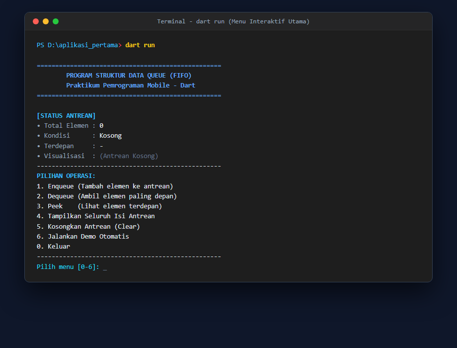
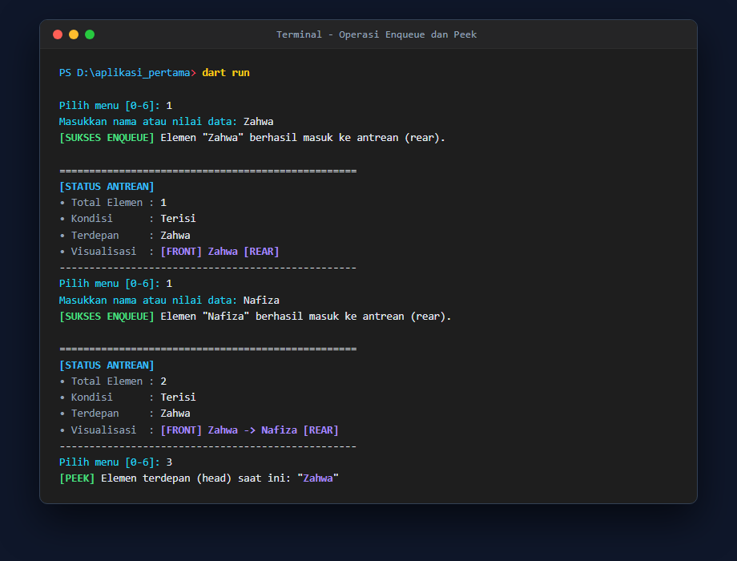
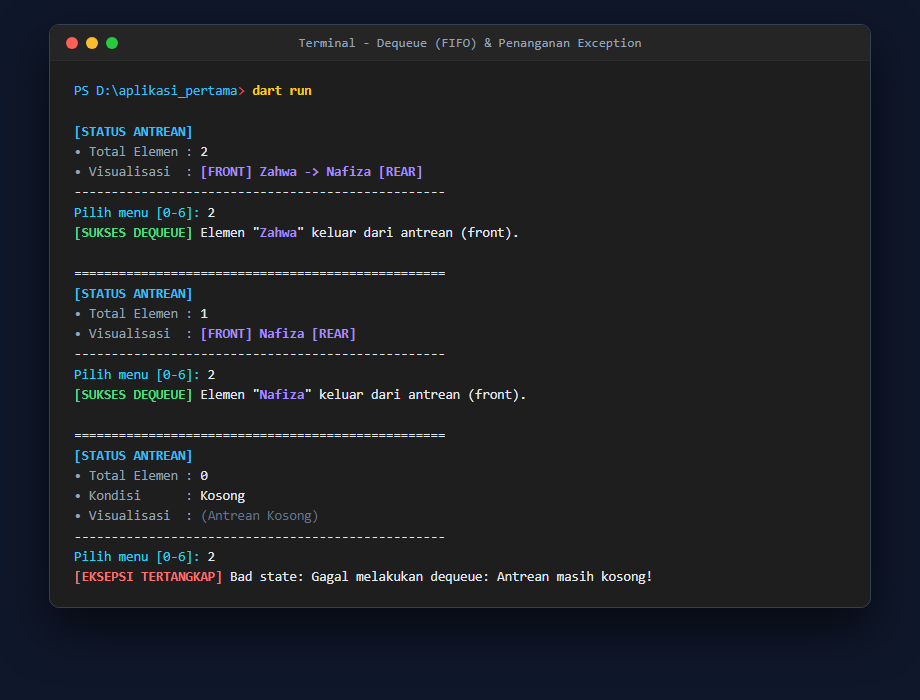
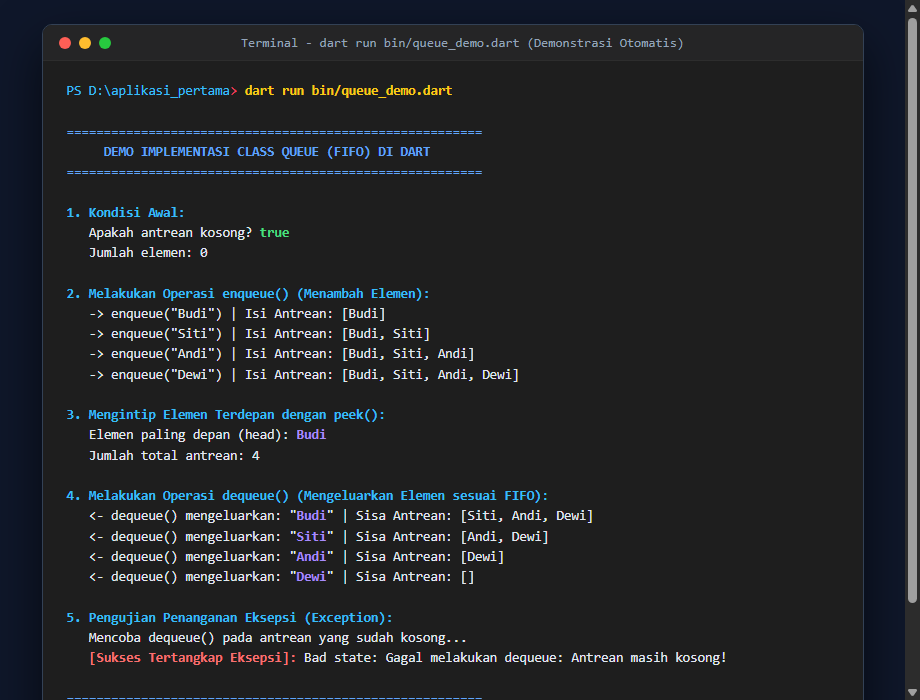
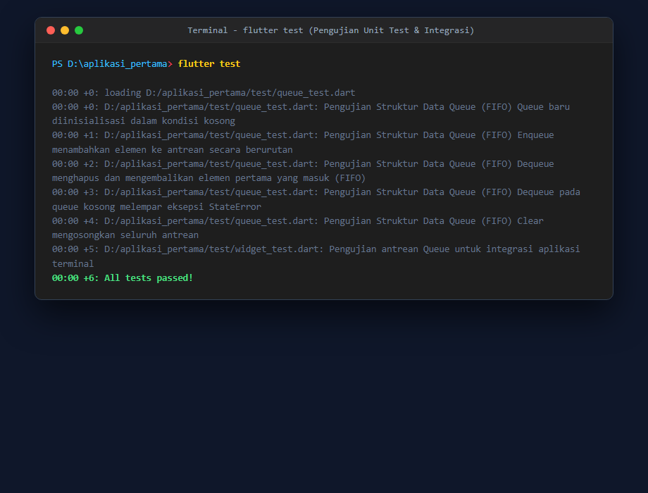

# Tugas Praktikum Pemrograman Mobile - Modul 1 (Bahasa Pemrograman Dart)
## Implementasi Struktur Data Antrean (Queue - FIFO)

---

### 👤 Identitas Mahasiswa
| Data | Keterangan |
| :--- | :--- |
| **Nama** | Zahwa Nafiza Azzahra |
| **NIM** | H1D024015 |
| **Shift KRS** | H |
| **Shift Sekarang** | F |

---

## 📖 Deskripsi Proyek
Proyek ini merupakan implementasi sederhana dari struktur data **Queue (Antrean)** berbasis konsol/terminal menggunakan bahasa pemrograman **Dart**, sesuai dengan materi pada **Modul 1 Praktikum Pemrograman Mobile**.

Struktur data **Queue** bekerja berdasarkan prinsip **FIFO (First In, First Out)**, yaitu elemen yang pertama kali dimasukkan ke dalam antrean akan menjadi elemen pertama yang dikeluarkan. Konsep-konsep inti Dart yang diterapkan dalam proyek ini meliputi:
1. **Pemrograman Berorientasi Objek (OOP)**: Penggunaan `class`, atribut privat (enkapsulasi), konstruktor, dan method.
2. **Generics (`<T>`)**: Memungkinkan antrean menyimpan berbagai jenis tipe data (String, int, objek kustom, dll.) secara aman (*type-safe*).
3. **Penanganan Eksepsi (Exception Handling)**: Menggunakan blok `try - catch` dan melempar `StateError` saat operasi `dequeue` dijalankan pada antrean yang kosong.
4. **Interaksi Terminal (Console I/O)**: Membaca input pengguna secara interaktif melalui `stdin.readLineSync()` dan menampilkan hasil dengan `stdout` serta `print`.
5. **Pengujian Otomatis (Unit Testing)**: Memvalidasi kebenaran logika FIFO, kapasitas antrean, pembersihan data, dan eksepsi.

---

## 📂 Struktur Berkas Proyek

```text
aplikasi_pertama/
├── bin/
│   ├── aplikasi_pertama.dart      # Entry point default saat mengeksekusi 'dart run'
│   └── queue_demo.dart            # Script eksekusi demo antrean otomatis (sekali jalan)
├── lib/
│   ├── main.dart                  # Program terminal interaktif dengan menu navigasi
│   └── queue.dart                 # Implementasi kelas generik Queue<T>
├── screenshots/                   # Tangkapan layar bukti eksekusi program di terminal
│   ├── 01_menu_utama.png
│   ├── 02_enqueue_peek.png
│   ├── 03_dequeue_exception.png
│   ├── 04_demo_otomatis.png
│   └── 05_unit_test.png
├── test/
│   ├── queue_test.dart            # Pengujian logika Queue (5 unit tests)
│   └── widget_test.dart           # Pengujian integrasi antrean
├── analysis_options.yaml          # Konfigurasi linter Dart & Flutter
├── pubspec.yaml                   # Konfigurasi dependensi proyek Dart/Flutter
└── README.md                      # Dokumentasi lengkap proyek
```

---

## 🔍 Penjelasan Detail Kode Program

### 1. `lib/queue.dart` (Kelas Utama Queue)
Berkas ini berisi logika murni dari struktur data antrean:
- **`class Queue<T>`**: Kelas generik yang dapat menampung elemen dengan tipe apa pun.
- **`final List<T> _items = []`**: Penyimpanan internal berupa `List` privat yang menerapkan enkapsulasi agar data tidak dapat diubah langsung dari luar kelas tanpa melalui method resmi.
- **`void enqueue(T element)`**: Menambahkan elemen baru ke bagian belakang (*rear/tail*) antrean menggunakan `_items.add(element)`.
- **`T dequeue()`**: Mengambil dan menghapus elemen terdepan (*front/head*) antrean menggunakan `_items.removeAt(0)`. Jika antrean kosong, method ini melempar `StateError('Gagal melakukan dequeue: Antrean masih kosong!')`.
- **`T? peek()`**: Mengintip elemen terdepan (`_items.first`) tanpa menghapusnya dari antrean. Mengembalikan `null` jika antrean kosong.
- **`bool get isEmpty` & `bool get isNotEmpty`**: Getter untuk memeriksa kondisi kekosongan antrean.
- **`int get length`**: Getter untuk mengetahui jumlah elemen yang ada di antrean saat ini.
- **`void clear()`**: Mengosongkan seluruh isi antrean menggunakan `_items.clear()`.
- **`List<T> toList()`**: Mengembalikan salinan data antrean dalam bentuk `List.unmodifiable` guna menjaga keamanan data (*immutability*).

### 2. `lib/main.dart` (Menu Interaktif Terminal)
Berkas ini bertindak sebagai antarmuka pengguna berbasis terminal (CLI):
- Menyajikan perulangan menu utama (`while (berjalan)`).
- Menampilkan status ringkas antrean (*Total Elemen*, *Kondisi*, *Elemen Terdepan*, dan *Visualisasi Alur FIFO*).
- Membaca pilihan menu pengguna menggunakan `stdin.readLineSync()`.
- Menangani operasi **Enqueue** dengan memvalidasi agar input tidak kosong.
- Menangani operasi **Dequeue** dengan blok `try ... catch (e)` sehingga ketika terjadi error saat antrean kosong, pesan eksepsi ditangkap dan ditampilkan dengan ramah tanpa membuat program crash.
- Menyediakan opsi **Clear**, **Tampilkan Daftar Lengkap**, dan **Demo Otomatis**.

### 3. `bin/aplikasi_pertama.dart` & `bin/queue_demo.dart`
- **`bin/aplikasi_pertama.dart`**: Menghubungkan perintah bawaan `dart run` langsung ke fungsi utama di `lib/main.dart`.
- **`bin/queue_demo.dart`**: Script demonstrasi mandiri yang menjalankan simulasi FIFO dari kondisi awal kosong, penambahan 4 data, operasi peek, pengeluaran data berurutan, hingga pengujian penangkapan eksepsi secara otomatis.

### 4. `test/queue_test.dart` (Pengujian Unit Test)
Berisi pengujian otomatis dengan skenario:
1. Inisialisasi antrean baru dalam keadaan kosong (`length == 0`, `isEmpty == true`).
2. Operasi `enqueue` menambah data berurutan ke belakang.
3. Operasi `dequeue` mengeluarkan data pertama yang masuk sesuai urutan FIFO.
4. Pengujian melempar eksepsi `StateError` saat `dequeue` dipanggil pada antrean kosong.
5. Operasi `clear` mengosongkan seluruh antrean.

---

## 🚀 Panduan Menjalankan Program

Pastikan Anda telah menginstal **Dart SDK** atau **Flutter SDK** pada komputer Anda. Buka terminal di direktori proyek ini, kemudian jalankan perintah di bawah:

### A. Menjalankan Aplikasi Terminal Interaktif
```bash
dart run
```
*Atau menggunakan path file langsung:*
```bash
dart run lib/main.dart
```

### B. Menjalankan Demonstrasi Otomatis Sekali Jalan
```bash
dart run bin/queue_demo.dart
```

### C. Menjalankan Unit Test (Pengujian Kode)
```bash
flutter test
```

---

## 📸 Tangkapan Layar Eksekusi Program (Screenshots)

### 1. Tampilan Menu Utama & Status Awal Antrean
Tangkapan layar saat program pertama kali dijalankan dengan perintah `dart run`. Terlihat banner program, status antrean yang masih kosong, dan daftar menu pilihan operasi (0 - 6).



---

### 2. Operasi Enqueue & Peek
Tangkapan layar saat menambahkan data baru ke dalam antrean (operasi `enqueue("Zahwa")` dan `enqueue("Nafiza")`). Terlihat elemen masuk ke posisi *rear* (belakang) serta operasi `peek()` yang menampilkan elemen terdepan (*head*), yaitu `"Zahwa"`.



---

### 3. Operasi Dequeue (FIFO) & Penanganan Eksepsi (Exception)
Tangkapan layar saat mengeluarkan elemen menggunakan operasi `dequeue()`. Elemen `"Zahwa"` keluar terlebih dahulu diikuti `"Nafiza"`. Ketika antrean sudah kosong dan pengguna mencoba melakukan `dequeue()` kembali, sistem menangkap eksepsi `StateError` secara aman melalui blok `try - catch`.



---

### 4. Demonstrasi Otomatis (`queue_demo.dart`)
Tangkapan layar saat menjalankan script `dart run bin/queue_demo.dart`. Menunjukkan demonstrasi otomatis lengkap dari penambahan 4 nama, pengecekan `peek()`, pengeluaran data secara FIFO, hingga pembuktian tertangkapnya eksepsi saat antrean kosong.



---

### 5. Hasil Pengujian Unit Test (`flutter test`)
Tangkapan layar saat menjalankan pengujian unit test dengan perintah `flutter test`. Semua pengujian (6 test cases) berhasil dilewati dengan status **All tests passed!** tanpa ada kendala.


